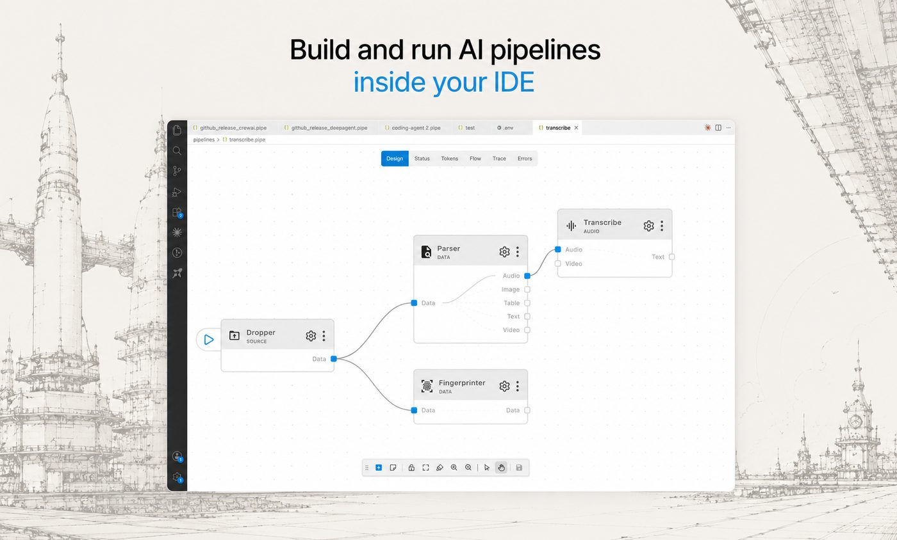

<p align="center">
  <a href="https://rocketride.org"></a>
</p>

<p align="center">
  <a href="https://github.com/rocketride-org/rocketride-apify-actor/actions/workflows/ci.yml"></a>
  <a href="./LICENSE"></a>
  <a href="https://docs.rocketride.org/"></a>
  <a href="https://discord.gg/PMXrtenMsY"></a>
</p>

# RocketRide - Meta harness

**Give your AI agent a private RocketRide engine on Apify: an MCP server to build and run AI pipelines, and six ready-made document and agent endpoints.**

This Actor runs the open-source [RocketRide](https://github.com/rocketride-org/rocketride-server) engine in Apify **Standby (Server) mode**. It stays warm between requests and exposes one URL:

```
https://rocketrideai--rocketride.apify.actor
```

Point Claude, Cursor, ChatGPT, n8n, LangChain or your own code at it and you get:

- **An MCP server** (`/mcp`) with 33 tools to discover about 150 nodes, then compose, validate, run and trace AI pipelines on RocketRide's C++ engine.
- **Ready-made pipelines** (`/pipelines/{name}`) you call with one HTTP request: extract text, redact PII, summarize, extract structured data, ask a document, and a research agent.

## Contents

- [Ready-made pipelines](#ready-made-pipelines)
- [Quickstart](#quickstart)
- [Connect your agent over MCP](#connect-your-agent-over-mcp)
- [Call a pipeline over HTTP](#call-a-pipeline-over-http)
- [API reference](#api-reference)
- [Input: bring your own model](#input-bring-your-own-model)
- [Pricing and performance](#pricing-and-performance)
- [FAQ](#faq)
- [Development](#development)
- [Support](#support)

## Ready-made pipelines

| Pipeline | What you get | LLM key |
| --- | --- | :---: |
| 📄 `doc-to-text` | Clean text from PDF, DOCX, PPTX, XLSX, HTML and images, with OCR | Not needed |
| 🛡️ `redact-pii` | The same text with names, organizations, places and other personal details masked | Not needed |
| 📝 `summarize` | A summary, key points and named entities | Required |
| 🧾 `extract-data` | The fields you name, returned as JSON rows | Required |
| ❓ `ask` | An answer to your question, grounded in the document | Required |
| 🤖 `agent` | A RocketRide agent that plans, fetches web pages and APIs, and answers | Required |

Need something else? Your agent can build it through the MCP server from about 150 nodes:

- **LLMs:** OpenAI, Anthropic, Gemini, Mistral, Bedrock, Ollama and more
- **Agent frameworks:** RocketRide, LangChain, CrewAI, LlamaIndex
- **Data:** vector, graph and SQL stores, embeddings, chunking
- **Documents:** OCR, NER, parsing
- **Tools:** HTTP, Python, GitHub, Slack, Notion, Apify

The engine validates every pipeline before it runs, so your agent gets precise errors instead of silent failures, and you can trace what each step did.

## Quickstart

1. **Get your token.** Copy your Apify API token from [Settings → API & Integrations](https://console.apify.com/settings/integrations).
2. **Add an LLM key (optional).** Only the LLM pipelines need one. Add it in the Actor's **Input** tab.
3. **Send a request.** Every request needs `Authorization: Bearer <APIFY_TOKEN>`. The first one starts your server; later ones hit the warm engine.

```bash
curl -X POST "https://rocketrideai--rocketride.apify.actor/pipelines/redact-pii" \
  -H "Authorization: Bearer $APIFY_TOKEN" -H "Content-Type: application/json" \
  -d '{"text": "Contact John Smith at john.smith@example.com in Seattle."}'
```

```json
{ "pipeline": "redact-pii", "text": "Contact ██████████ at ██████████@███████████ in ███████." }
```

## Connect your agent over MCP

**Claude Code**

```bash
claude mcp add --transport http rocketride https://rocketrideai--rocketride.apify.actor/mcp \
  --header "Authorization: Bearer $APIFY_TOKEN"
```

**Cursor, VS Code, Claude Desktop and other clients** (`mcp.json`)

```json
{
  "mcpServers": {
    "rocketride": {
      "url": "https://rocketrideai--rocketride.apify.actor/mcp",
      "headers": { "Authorization": "Bearer <APIFY_TOKEN>" }
    }
  }
}
```

Then ask your agent something like:

> Use RocketRide to build a pipeline that takes a PDF invoice, extracts the vendor, total and due date with GPT-4o mini, and returns JSON. Validate it, then run it on this file.

The tools cover the whole loop: `list_components`, `describe_component`, `validate_pipeline`, `run_pipeline`, `send_data`, `monitor`, `terminate` and more. See the [MCP tool reference](https://docs.rocketride.org/connect/mcp/http/tools).

## Call a pipeline over HTTP

Send a document in any of three ways:

- **JSON:** `{"text": "..."}` or `{"url": "https://..."}`, with options in the body
- **Raw bytes:** the file as the body with its `Content-Type`, options in the query string
- **Multipart:** `multipart/form-data`, options in the query string

Add `?save=true` to also store the result in the run's dataset.

**Summarize a PDF**

```bash
curl -X POST "https://rocketrideai--rocketride.apify.actor/pipelines/summarize" \
  -H "Authorization: Bearer $APIFY_TOKEN" -H "Content-Type: application/json" \
  -d '{"url": "https://arxiv.org/pdf/1706.03762", "summaryWords": 150}'
```

The `text` field holds a summary paragraph, a `Key Points:` list and an `Entities:` list.

**Extract structured data from an invoice**

```bash
curl -X POST "https://rocketrideai--rocketride.apify.actor/pipelines/extract-data?fields=invoice_number,total,due_date" \
  -H "Authorization: Bearer $APIFY_TOKEN" -H "Content-Type: application/pdf" \
  --data-binary @invoice.pdf
```

```json
{
  "pipeline": "extract-data",
  "filename": "invoice.pdf",
  "durationMs": 2140,
  "data": [{ "invoice_number": "INV-2026-0042", "total": "960.00", "due_date": "2026-12-01" }]
}
```

For typed columns, send JSON: `"fields": [{"name": "total", "type": "decimal"}, {"name": "due_date", "type": "date"}]`.

**Ask a question about a document**

```bash
curl -X POST "https://rocketrideai--rocketride.apify.actor/pipelines/ask" \
  -H "Authorization: Bearer $APIFY_TOKEN" -H "Content-Type: application/json" \
  -d '{"url": "https://example.com/contract.pdf", "question": "What is the notice period?"}'
```

The answer is in the `answer` field.

**Run the research agent**

```bash
curl -X POST "https://rocketrideai--rocketride.apify.actor/pipelines/agent" \
  -H "Authorization: Bearer $APIFY_TOKEN" -H "Content-Type: application/json" \
  -d '{"question": "What changed in the latest Python release? Check python.org and cite the page."}'
```

## API reference

### Endpoints

| Endpoint | Purpose |
| --- | --- |
| `POST /pipelines/{name}` | Run a ready-made pipeline |
| `GET /pipelines` | List pipelines, their options and your configured LLM providers |
| `GET /pipelines/{name}` | Get the `.pipe` definition a request would run, to reuse or edit |
| `POST /run` | Run any webhook-source `.pipe` once: `{"pipeline": {...}, "text": "..."}` |
| `POST /mcp` | RocketRide MCP server (Streamable HTTP) |
| `/engine/...` | Pass-through to the engine's native HTTP API |
| `GET /health` | Engine status |

### Pipeline options

| Option | Pipelines | Meaning |
| --- | --- | --- |
| `provider` | LLM pipelines | `openai`, `anthropic`, `gemini` or `openai-compatible`. Default: the first one you configured |
| `model` | LLM pipelines | Model id at that provider, such as `gpt-4o-mini`. Default: the node's default model |
| `ocr` | summarize, extract-data, ask | `true` to OCR scanned pages and images. Default: `false` |
| `question` | ask, agent | Required |
| `fields` | extract-data | Required. Column names, or objects with `name`, `type`, `default` |
| `summaryWords`, `keyPoints`, `entities`, `chunks` | summarize | Length and sections of the summary |
| `instructions`, `web`, `maxSteps` | agent | System prompt, HTTP tool on or off, max plan/act rounds |

## Input: bring your own model

All input is optional. The document pipelines, and the MCP tools for building and validating pipelines, work with no keys.

| Input field | Pipelines see it as |
| --- | --- |
| OpenAI API key | `${ROCKETRIDE_OPENAI_KEY}` |
| Anthropic API key | `${ROCKETRIDE_ANTHROPIC_KEY}` |
| Google Gemini API key | `${ROCKETRIDE_GEMINI_KEY}` |
| OpenAI-compatible endpoint URL, model and key (OpenRouter, Groq, Together, Ollama) | `${ROCKETRIDE_LLM_BASE_URL}`, `${ROCKETRIDE_LLM_MODEL}`, `${ROCKETRIDE_LLM_KEY}` |
| Default model | Used when a request names no `model` |
| Other node credentials (JSON) | Any `ROCKETRIDE_*` name, for vector stores, search, GitHub and more |

Secret fields are encrypted by Apify and decrypted only inside your run. Pipelines refer to keys by variable name, so a key never appears in a pipeline definition.

## Pricing and performance

The Actor is **free**. You pay Apify for platform usage while your server runs, and your LLM provider for model calls. Apify's free plan credits are enough to try every pipeline.

- **Private server.** Each user gets a single-tenant server in their own Apify account.
- **Starts on demand.** The server starts on the first request and stops after the idle timeout you set in **Settings → Server**.
- **4 GB of memory.** This is the minimum and the recommended setting. With all six pipelines loaded, the server used about 3 GB in our tests.
- **Warm requests are fast.** A short text document takes a fraction of a second, plus LLM time. OCR and entity detection take longer.
- **New pipelines take a few seconds to start.** LLM pipelines are built from your options. The three most recent stay running, so repeating a request with the same options skips the start.
- **The first start on a new machine is slow.** Apify downloads the image (engine plus OCR and entity models) once, which can take a few minutes. After that the server boots in seconds.

## FAQ

### What is a meta-harness?

An agent harness runs one agent. A meta-harness runs the whole stack around it: models, tools, memory, data stores, document processing and other agent frameworks, wired together as a pipeline you can validate, observe and deploy. RocketRide runs those pipelines on a multithreaded C++ engine.

### Can I edit the ready-made pipelines?

Yes. `GET /pipelines/{name}` returns the definition, and every one is also in [`pipelines/`](https://github.com/rocketride-org/rocketride-apify-actor/tree/main/pipelines) as a `.pipe` file. Open it in the [RocketRide VS Code extension](https://marketplace.visualstudio.com/items?itemName=RocketRide.rocketride) to edit it on a visual canvas, then run your version through `/run` or the MCP `run_pipeline` tool.

<a href="https://docs.rocketride.org/"></a>

### Is my data private?

Each server is single-tenant. Your files, pipelines and keys stay inside your own Actor run, and only requests carrying a token for your Apify account reach it.

### How is this different from RocketRide Cloud?

[RocketRide Cloud](https://cloud.rocketride.ai/) is RocketRide's hosted runtime. This Actor gives you a private engine inside your Apify account, billed through Apify. It suits agents and automations that already live on Apify.

### Can I call this from n8n, Make or Zapier?

Yes. Use an HTTP request step with your Apify token in the `Authorization` header. Going the other way, a pipeline can trigger an n8n workflow with the `tool_n8n` node.

### Is RocketRide open source?

Yes. The engine is [MIT-licensed on GitHub](https://github.com/rocketride-org/rocketride-server), and so is this Actor.

### What are the known limitations?

- **CPU only.** Nodes that need a GPU will be slow or will not work here.
- **PII detection is model-based.** It reliably masked names, organizations and places in our tests, but it can miss items such as the domain of an email address. Review the output before relying on it for compliance.
- **`send_files` reads from the container.** The MCP `send_files` tool and upload links read from the Actor's container, not your machine. To send your own files, use `send_data`, a pipeline endpoint, or `/run` with a URL.
- **Restarts clear running pipelines.** They live in the server's memory. Save results with `?save=true`.
- **Extra nodes install on first use.** Nodes outside the ready-made pipelines install their dependencies the first time they run, so that run is slower.

## Development

This repo is the Actor's source. The image is built on a pinned RocketRide engine release.

| Path | What it is |
| --- | --- |
| [`src/main.py`](src/main.py) | HTTP layer in front of the engine: auth, `/mcp`, `/pipelines`, `/run`, `/engine` |
| [`src/pipelines.py`](src/pipelines.py) | Catalog and builders for the ready-made pipelines |
| [`src/apify_env.py`](src/apify_env.py) | Reads Actor input and decrypts secret fields, without the Apify SDK |
| [`pipelines/`](pipelines/) | The ready-made pipelines as `.pipe` files, generated by `scripts/export_pipes.py` |
| [`scripts/prepare_image.py`](scripts/prepare_image.py) | Build-time image prep: CPU-only PyTorch, baked-in models |
| [`.actor/`](.actor/) | Actor config, input schema and OpenAPI schema |
| [`tests/`](tests/) | Unit tests against a mock engine, and Docker integration tests |

Run the checks CI runs:

```bash
pip install starlette uvicorn httpx cryptography python-multipart
python scripts/export_pipes.py --check   # .pipe files are up to date
python tests/test_local.py               # wrapper against a mock engine
bash tests/integration.sh                # builds the image and tests the real engine (needs Docker)
```

## Support

- **Bugs and feature requests:** [GitHub issues](https://github.com/rocketride-org/rocketride-apify-actor/issues) or the Actor's **Issues** tab on Apify
- **Community:** [RocketRide Discord](https://discord.gg/PMXrtenMsY)
- **Docs:** [docs.rocketride.org](https://docs.rocketride.org/), and [llms.txt](https://docs.rocketride.org/llms.txt) for agents
- **Project home:** [rocketride.org](https://rocketride.org)
